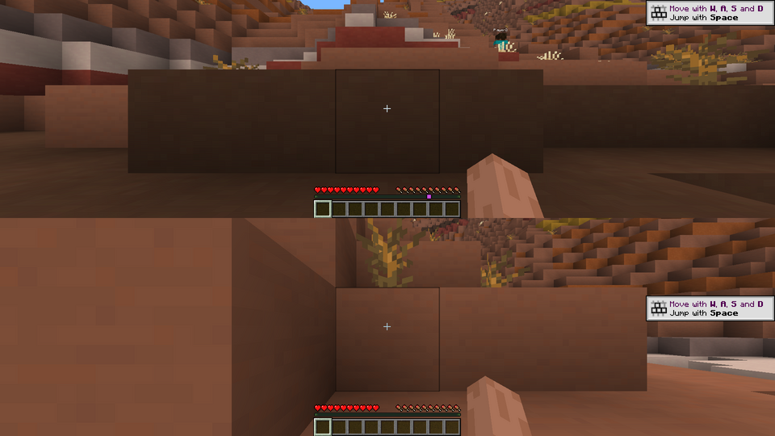

# Splitty

Local two-player split screen for Minecraft Java Edition 26.3 (Fabric).
Player 1 uses the keyboard and mouse, Player 2 uses a controller through
[Controlify](https://modrinth.com/mod/controlify). It works for local worlds only and has no online play.



## How it works

Java Edition can only show one player per game, so Splitty runs **two copies of the game side by side**:

| | Player 1 (host) | Player 2 (guest) |
|---|---|---|
| Input | Keyboard + mouse | Controller (Controlify) |
| Window | Top half (or left) | Bottom half (or right) |
| World | Opens your single-player world | Joins Player 1's world automatically |

Splitty handles the setup work for you:

- **Window layout.** Each game window becomes borderless and is placed in its half of the screen.
- **Auto open to LAN.** When Player 1 loads a single-player world, Splitty opens it to LAN on a free port.
  It also allows offline accounts, so Player 2 doesn't need a second Microsoft account.
- **Auto join.** Player 2's title screen watches for Player 1's world and joins it. There is also a
  **Join Player 1** button on the title screen.
- **Separate inputs.** While Player 2 is in a world, their window ignores the real keyboard and mouse. A
  stray click in their half can't move them, and the mouse stays with Player 1.
- **Controller works in the background.** Player 2 automatically gets Controlify's "Out of Focus
  Input" setting turned on, because their window almost never has focus.
- **No pausing.** Only one window can have focus at a time, so Splitty turns off "pause when the window
  loses focus" and the vanilla low-FPS AFK throttle for both games.

## What you need

- Minecraft **26.3** with Fabric Loader **0.19.5+**. Prism downloads Java 25 for you.
- [Fabric API](https://modrinth.com/mod/fabric-api) in both instances
- Splitty in both instances
- [Controlify](https://modrinth.com/mod/controlify) in **Player 2's instance only**

## Quick setup on Fedora

[`scripts/setup-fedora.sh`](scripts/setup-fedora.sh) sets everything up for the Flatpak version of
Prism Launcher:

- installs Prism, XWayland and controller udev rules if missing (it asks before using `sudo`)
- creates the `Splitty-P1` and `Splitty-P2` instances with the right mods and roles
- adds a **Splitty Split Screen** entry to your app menu that starts both players

```sh
# Download splitty-x.y.z.jar from the Releases page to ~/Downloads first, then:
git clone https://github.com/iSaluki/splitty.git
./splitty/scripts/setup-fedora.sh
```

Options: `--splitty-jar PATH`, `--p2-name NAME` (Player 2's offline name, default `Player2`),
`--memory MB` (default 4096 per game), `--layout top_bottom|left_right`, `--skip-system`, `--yes`.
Close Prism before running it. You can run it again to update the mods; worlds and your own mods are
kept.

After it finishes, open Prism once and sign in with your Microsoft account. Then start
**Splitty Split Screen** from the app menu.

## Manual setup in Prism Launcher

1. **Create Player 1's instance.** Add Instance → Minecraft 26.3 → Fabric. Name it `Splitty P1`. Add
   Fabric API and Splitty (`splitty-x.y.z.jar`) to its Mods. **Do not add Controlify here**, or the
   controller will move both players.
2. **Create Player 2's instance.** Right-click `Splitty P1` → Copy, and name the copy `Splitty P2`. Add
   Controlify (and anything Controlify says it needs) to this instance only.
3. **Set each instance's role.** Pick either option:
   - Click the **Splitscreen: …** button in the top-left of the title screen. Set it to *P1 Keyboard* in
     P1 and *P2 Controller* in P2, then restart both games once.
   - Or go to Edit Instance → Settings → Java → JVM arguments. Add `-Dsplitty.role=host` to P1 and
     `-Dsplitty.role=guest` to P2. This setting overrides the button.
4. **Give Player 2 a different name.** One account can't be in the same world twice. Launch P2 with
   right-click → **Launch Offline** and enter a name like `Player2`, or use a second account.
5. **Play.** Launch both instances. In P1, open or create a single-player world. P2 joins within a few
   seconds. You'll see `[Splitty] World opened to LAN…` in P1's chat.

Tips:

- P1's mouse can't leave P1's window during play, so P2's window never steals focus. If you click into P2's
  half from a menu, click back into P1's half.
- Both games play sound. Turn down Music in one of them to avoid hearing it twice.
- Running two games uses twice the memory. Give each instance about 3–4 GB (Settings → Java → Memory).
- In P2's menus, Controlify's button navigation works best. If the mouse pointer jumps around while P2
  browses menus, turn off Controlify's virtual mouse for that screen.

## Fedora / Wayland notes

Wayland doesn't let a game choose where its window goes. To work around this, Splitty asks SDL (the window
library Minecraft 26.x uses) to run through **XWayland**, which Fedora includes by default. Check your
`latest.log` after launching:

```
[Splitty] Placed host window at 0,0 size 1920x540 (video driver: x11)
```

If the log says `video driver: wayland`, the windows won't move on their own. To fix that:

- If you installed Prism as a **Flatpak**, give it X11 access:
  `flatpak override --user --socket=x11 org.prismlauncher.PrismLauncher`
- Make sure `SDL_VIDEO_DRIVER` isn't set in Prism's environment variables, because it overrides Splitty.
- If none of that works, set `"borderless": false` and arrange the two windows yourself. On GNOME,
  Super+Up / Super+Down or Super+Left / Super+Right will snap them.

## Configuration

Each instance has its own `config/splitty.json`, which is created on first launch:

| Option | Default | Meaning |
|---|---|---|
| `role` | `"off"` | `"host"` (P1, keyboard), `"guest"` (P2, controller) or `"off"`. `-Dsplitty.role=…` overrides it. |
| `layout` | `"top_bottom"` | `"top_bottom"` or `"left_right"` |
| `swapSides` | `false` | Put P2 in the top/left half instead |
| `monitor` | `-1` | Which display to use: `-1` = primary, `0`, `1`, … = by index |
| `borderless` | `true` | Remove window title bars so the halves fit together exactly |
| `forceX11` | `true` | Prefer XWayland over native Wayland so windows can be placed (Linux) |
| `autoOpenLan` | `true` | Host: open single-player worlds to LAN automatically |
| `allowOfflineGuests` | `true` | Host: allow non-Microsoft (offline) accounts to join |
| `lanPort` | `0` | Host: fixed LAN port; `0` picks a free one |
| `allowGuestCommands` | `false` | Host: give P2 access to commands/cheats |
| `autoJoin` | `true` | Guest: join P1 automatically from the title screen |
| `blockKeyboardMouseInWorld` | `true` | Guest: ignore real keyboard/mouse while in a world |
| `sessionFile` | `""` | Where P1 tells P2 its port. Empty uses the system temp directory. Both instances must use the same path. |

## Building

```sh
./gradlew build   # needs JDK 25; the jar is written to build/libs/
```

For development, `./gradlew runClient` starts Player 1 and `./gradlew runGuest` starts Player 2. Run them
in two terminals.
